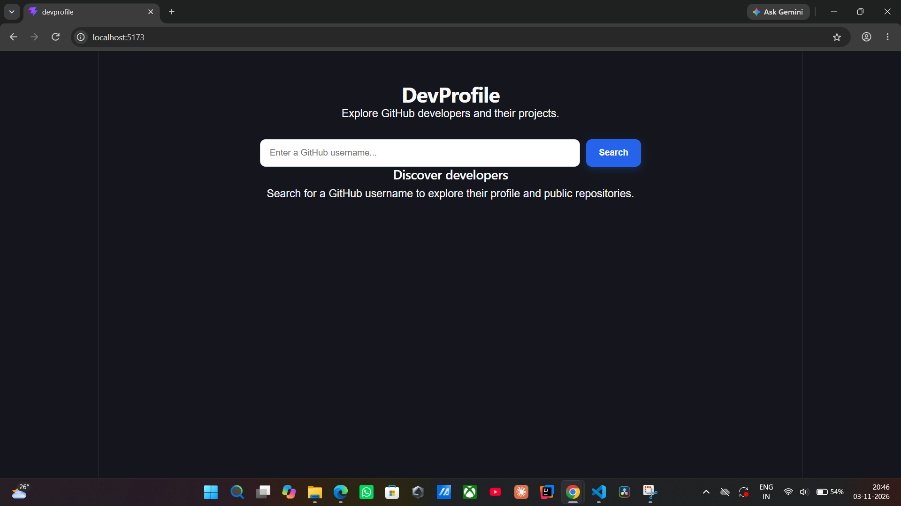
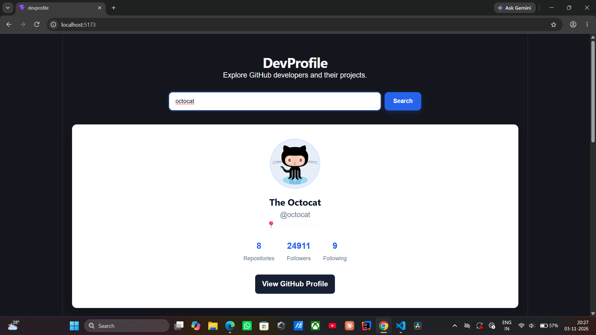
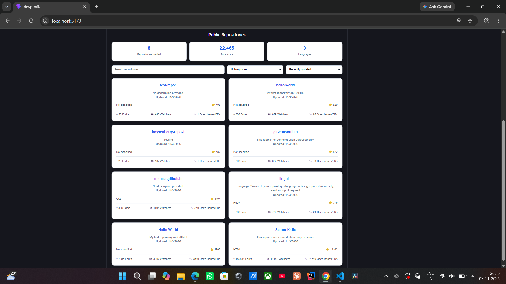

# 🚀 DevProfile — GitHub Profile Explorer

DevProfile is a React-based web application that helps users explore GitHub developer profiles and their public repositories using a GitHub username.

## 📸 Screenshots

### Home Page


### Developer Profile and Repositories



## ✨ Features

- Search GitHub developers by username.
- View profile pictures, names, bios, and locations.
- Display followers, following, and public repository counts.
- Explore public repositories.
- Search repositories by name or description.
- Filter repositories by programming language.
- Sort repositories by stars, recently updated, and name.
- View repository statistics, including stars and languages.
- Display repository forks, watchers, and open issues.
- Load additional repositories using pagination.
- Handle invalid usernames, network failures, and API errors.
- Responsive interface for desktop and mobile screens.

## 🛠️ Technologies Used

- React.js
- JavaScript
- HTML5
- CSS3
- GitHub REST API
- Vite

## ⚙️ Installation and Setup

### 1. Clone the repository

```bash
git clone https://github.com/Refana1904/DevProfile.git
```

### 2. Navigate to the project directory

```bash
cd DevProfile
```

### 3. Install dependencies

```bash
npm install
```

### 4. Start the development server

```bash
npm run dev
```

### 5. Open the application

Visit the local URL displayed in your terminal, usually:

`http://localhost:5173/`

## 🔗 GitHub API

This application uses the GitHub REST API.

- **User Profile:** `https://api.github.com/users/{username}`
- **Repositories:** `https://api.github.com/users/{username}/repos`

## 🎯 Project Objective

To build an interactive GitHub developer explorer while gaining practical experience in React, API integration, state management, and responsive frontend development.

## 👩‍💻 Author

**Refana S**

B.Tech Information Technology

GitHub: [Refana1904](https://github.com/Refana1904)

---

*Built with React and Vite.*
